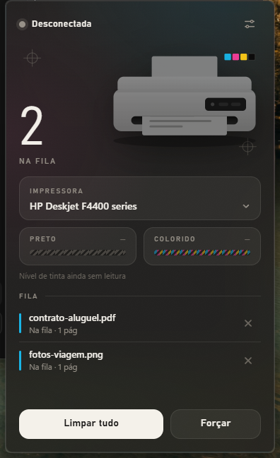

# Fila de Impressão

Painel na bandeja do Windows para ver e limpar a fila de impressão. Rust + Tauri, um exe só.



- Ícone perto do relógio. Clique abre o painel; clicar fora fecha. Botão direito: limpar fila, iniciar com o Windows, sair.
- Mostra se a impressora está **realmente** conectada. O Windows diz "pronta" para impressora USB fora do cabo; o app pergunta ao gerenciador de dispositivos.
- Lista os jobs da impressora escolhida, atualiza a cada 1,5 s.
- **Cancelar** um job ou **Limpar tudo**: usa a API do spooler, sem admin.
- **Forçar**: para job que não sai. Pede admin, para o spooler, apaga os arquivos em `System32\spool\PRINTERS` e liga o spooler de novo. Apaga a fila de **todas** as impressoras.
- Nível de tinta: ainda não lido. As barras aparecem hachuradas até isso existir.

## Rodar

Precisa do WebView2, que já vem no Windows 11.

```bash
cargo run --release
```

`--pin` mantém o painel aberto ao perder o foco (útil para mexer no visual). `--background` inicia só na bandeja.

## Estrutura

- `src/spooler.rs`: API do spooler do Windows.
- `src/device.rs`: impressora conectada ou não.
- `src/force.rs`: limpeza forçada com elevação.
- `src/status.rs`: textos de status.
- `src/main.rs`: bandeja, janela, comandos chamados pelo painel.
- `ui/`: o painel (HTML, CSS e JS puros, sem build).
- `scripts/make-icons.ps1`: regenera os ícones.

## Testar

```bash
cargo test
```

O teste que mexe em fila de verdade fica desligado por padrão. Ele cria jobs pausados na `Microsoft Print to PDF` e limpa; nada é impresso.

```bash
cargo test -- --ignored
```
